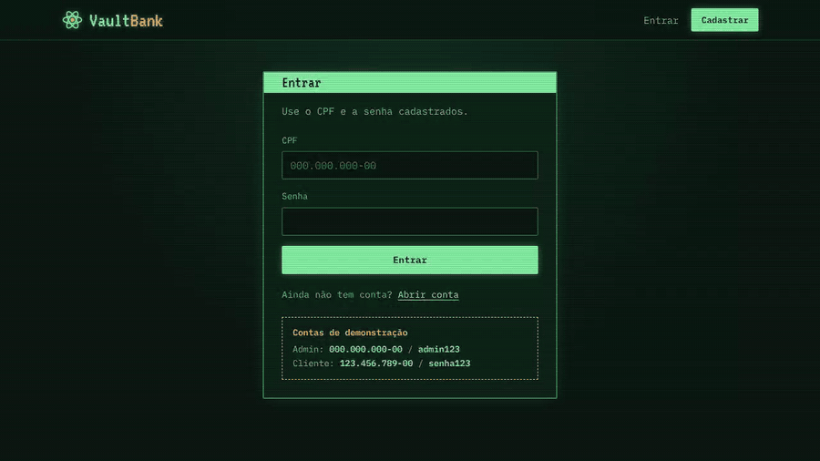
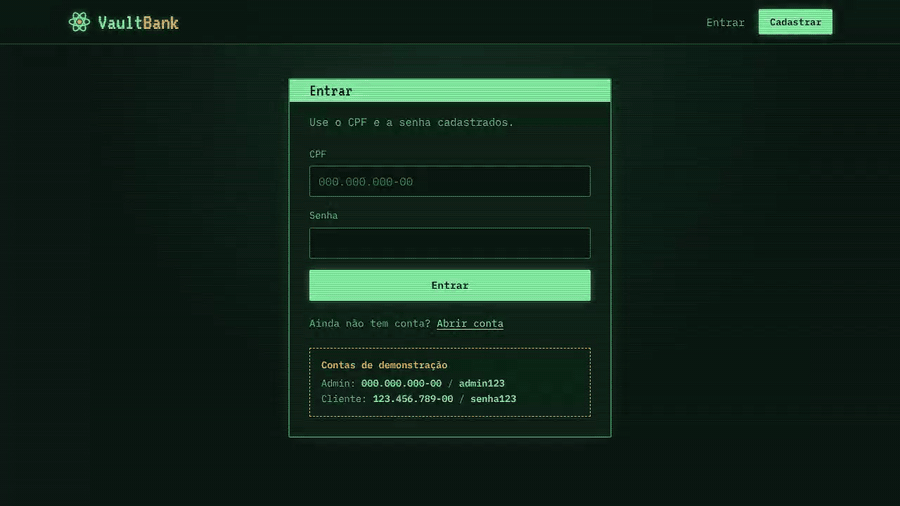

# VaultBank

Simulador de cartão de crédito feito em Java. O cliente abre a conta, recebe um cartão na hora, registra compras, acompanha o extrato e contesta cobranças. O administrador analisa as contestações, faz reembolsos e decide pedidos de aumento de limite.

O nome e o visual de terminal de fósforo verde são uma homenagem aos computadores retrô-futuristas da série Fallout.


## Funcionando

**Cliente:** login, painel com saldo e extrato, registro de uma compra.



**Administrador:** contestações, pedidos de limite e lista de clientes.



## Funcionalidades

**Cliente**
- Cadastro com cartão gerado automaticamente (número e validade)
- Painel com saldo disponível, total de compras e gasto do mês
- Extrato com compras e reembolsos em ordem cronológica
- Registro de compras
- Contestação de compras (fraude, valor incorreto, produto não recebido, cobrança duplicada)
- Pedido de aumento de limite
- Aviso de fechamento da fatura no dia 30

**Administrador**
- Contestações abertas, com reembolso direto para o saldo do cliente
- Pedidos de aumento de limite para aprovar ou negar
- Lista de todos os clientes com saldo

## Tecnologias

| Camada | Tecnologia |
| --- | --- |
| Linguagem | Java 21 |
| Servidor web e API | Javalin 6 |
| Banco de dados | MySQL |
| Pool de conexões | HikariCP |
| Migrações | Flyway |
| JSON | Jackson |
| Build | Maven (jar único com maven-shade-plugin) |
| Frontend | HTML, CSS e JavaScript puros |
| Deploy | Railway |

## Como rodar localmente

**Pré-requisitos:** Java 21, Maven e um MySQL rodando.

1. Crie o banco vazio. As tabelas são criadas pelo Flyway na primeira execução.

   ```sql
   CREATE DATABASE vaultbank;
   ```

2. Configure as variáveis de ambiente. O arquivo `.env.example` lista todas. A aplicação lê direto do sistema, então defina antes de rodar. No PowerShell:

   ```powershell
   $env:DB_URL = "jdbc:mysql://localhost:3306/vaultbank?useSSL=false&allowPublicKeyRetrieval=true&serverTimezone=America/Sao_Paulo"
   $env:DB_USER = "root"
   $env:DB_PASSWORD = "sua_senha"
   $env:ADMIN_CPF = "000.000.000-00"
   $env:ADMIN_SENHA = "admin123"
   ```

   No Linux ou macOS, use `export DB_URL="..."` e assim por diante.

3. Gere o jar e rode:

   ```bash
   mvn package
   java -jar target/CartaoDeCredito-1.0-SNAPSHOT.jar
   ```

4. Acesse `http://localhost:7071`.

### Variáveis de ambiente

| Variável | Obrigatória | Padrão | Para que serve |
| --- | --- | --- | --- |
| `DB_URL` | sim | | URL JDBC do MySQL |
| `DB_USER` | sim | | Usuário do banco |
| `DB_PASSWORD` | sim | | Senha do banco |
| `PORT` | não | `7071` | Porta do servidor |
| `APP_ENV` | não | `dev` | Ambiente (`dev` ou `prod`) |
| `ADMIN_CPF` | não | | CPF da conta admin criada na inicialização |
| `ADMIN_SENHA` | não | | Senha da conta admin |
| `SALDO_INICIAL` | não | `0.00` | Saldo de quem abre conta |

### Primeiro acesso

Se `ADMIN_CPF` e `ADMIN_SENHA` estiverem definidas, a conta admin é criada sozinha quando o servidor sobe. Para testar o lado do cliente, crie uma conta pela tela de cadastro.

## Estrutura

```
src/main/java
├── com/mycompany/cartaodecredito
│   ├── CartaoDeCredito.java     ponto de entrada
│   └── config/                  leitura do ambiente, pool e migrações
├── Connect/ApiServer.java       rotas da API
├── Dao/                         acesso ao banco
└── Model/                       entidades
src/main/resources
├── db/migration/                scripts do Flyway
└── public/                      páginas, CSS e JavaScript
```

## API

| Método | Rota | Descrição |
| --- | --- | --- |
| POST | `/api/login` | Autentica por CPF e senha |
| POST | `/api/clientes` | Cadastra cliente e gera o cartão |
| GET | `/api/clientes` | Lista clientes |
| GET | `/api/cartoes/{idCliente}` | Cartões do cliente |
| POST | `/api/compras` | Registra uma compra |
| GET | `/api/compras/{idCliente}` | Compras do cliente |
| POST | `/api/denuncias` | Abre uma contestação |
| GET | `/api/denuncias/pendentes` | Contestações abertas |
| POST | `/api/denuncias/{id}/reembolsar` | Reembolsa a compra contestada |
| GET | `/api/reembolsos` | Todos os reembolsos |
| GET | `/api/reembolsos/{idCliente}` | Reembolsos do cliente |
| POST | `/api/solicitacoes-limite` | Pede aumento de limite |
| GET | `/api/solicitacoes-limite/pendentes` | Pedidos aguardando decisão |
| POST | `/api/solicitacoes-limite/{id}/aprovar` | Aprova o pedido |
| POST | `/api/solicitacoes-limite/{id}/negar` | Nega o pedido |

## Equipe

- [Vinicius Lourenço](https://github.com/ViniciusVLM)
- [Giovanna Galichio](https://github.com/Giihgallicchio)
- [Thiago Pereira](https://github.com/thiagopereira-al)

---

Projeto acadêmico, sem fins comerciais e sem vínculo com a Bethesda ou com a franquia Fallout.
